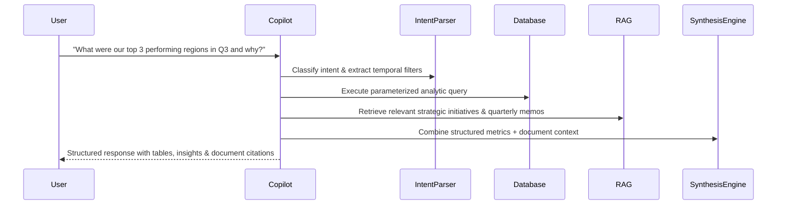

# OpsIntel Business AI Copilot

The OpsIntel AI Copilot provides conversational operational intelligence with real database query synthesis and deterministic verification.

## Architecture

## Supported Reasoning Capabilities
1. **Financial Performance Summaries**: Inquiring about MRR, ARR, CAC, gross margin, regional variances.
2. **Predictive Interrogation**: Querying forecast trends, high-risk churn accounts, and upcoming inventory deficits.
3. **Root-Cause Analysis**: Cross-referencing operational dips with supply chain delivery delays and regional sales attrition.
4. **Actionable Recommendations**: Automatic generation of remediation playbooks based on indexed SOPs.
