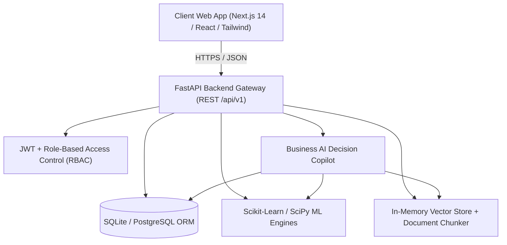

# OpsIntel Platform Architecture

## Executive Architecture Overview

OpsIntel is an enterprise-grade AI-powered business operations intelligence platform. It bridges real-time transactional enterprise data (ERP/CRM/Inventory) with predictive machine learning pipelines and a hybrid RAG-augmented business copilot.

## System Topology & Micro-Components

### 1. Presentation Tier (`apps/web`)
- **Framework**: Next.js 14 with App Router architecture
- **Design System**: Tailored dark-mode enterprise UI inspired by Linear & Datadog
- **Component Primitives**: KPI metric cards, interactive status badges, searchable data tables with multi-filter and sort, command palette (`Cmd+K`), notification popovers, responsive navigation shell
- **Visualizations**: Recharts-based multi-horizon forecasting charts with 95% confidence intervals, customer cohort matrices, churn probability distributions, and inventory lead-time analysis

### 2. Application & API Tier (`apps/api`)
- **Runtime**: Python 3.10+ / FastAPI / Uvicorn ASGI
- **ORM & Data Layer**: SQLAlchemy 2.0 with type annotations and Alembic migration compatibility
- **Security & RBAC**: OAuth2 password flow with HMAC-SHA256 JWT tokens, granular role authorization (`admin`, `manager`, `analyst`, `sales_rep`)
- **Validation**: Pydantic v2 schemas with unified envelope response structures (`APIResponse[T]`)

### 3. Machine Learning & Statistical Inference Tier
- **Sales Forecast Engine**: Multi-horizon ARIMA/linear regression with monthly seasonality indices and 95% parametric confidence bands
- **Customer Churn Engine**: Feature importance-backed Logistic Regression/Gradient Boosting scoring customer RFM and interaction velocity
- **Stockout Prediction Engine**: Empirical daily demand rate, supplier lead-time distribution, and Economic Order Quantity (EOQ) optimization
- **Target Achievement Simulator**: 1,000-run Monte Carlo simulation modeling attainment probabilities and shortfall risks
- **Anomaly Detection**: Multivariable statistical Z-score and Isolation Forest outlier scoring on operational revenue and order volumes
- **Customer Segmentation**: RFM K-Means clustering algorithm generating distinct customer persona tiers

### 4. Hybrid AI Copilot & RAG Knowledge Engine
- **Vector Retrieval**: Custom pure-Python cosine similarity vector engine (`VectorStore`) indexing chunked operational PDFs, SOPs, and governance docs
- **Reasoning Engine**: Structured natural language intent parsing with automated database query generation, metric aggregation, anomaly synthesis, and cited executive summaries
