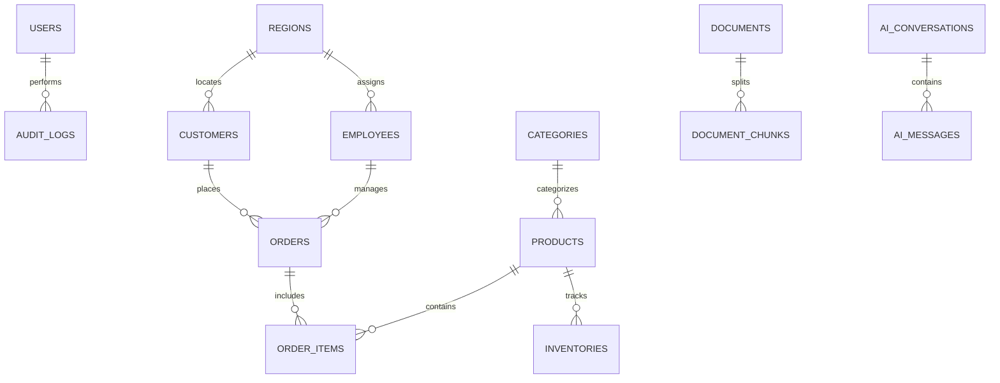

# OpsIntel Database Schema & Data Models

OpsIntel operates on a normalized relational schema modeled in SQLAlchemy 2.0.

## Entity Relationship Overview

## Core Tables

| Table | Purpose | Key Indexes |
| :--- | :--- | :--- |
| `users` | Enterprise user accounts, hashed passwords, RBAC roles | `email` (unique) |
| `regions` | Geographic sales territories and target allocations | `code` (unique) |
| `employees` | Sales representatives, team leads, department heads | `employee_code`, `email` |
| `categories` | Product hierarchy taxonomy | `name` (unique) |
| `products` | Enterprise hardware, software licenses, SaaS subscriptions | `sku` (unique), `category_id` |
| `inventories` | Current stock, lead time, stockout risk level, EOQ parameters | `product_id` (unique) |
| `customers` | Accounts, lifetime value, churn risk score, RFM segment | `customer_code`, `email` |
| `orders` | Sales transactions, revenue, delivery tracking, payment status | `order_number` (unique), `customer_id` |
| `order_items`| Line-item pricing, quantities, discounts, and SKU relations | `order_id`, `product_id` |
| `sales_targets`| Quarterly quotas, attainment metrics, Monte Carlo simulations | `employee_id`, `region_id` |
| `anomalies` | Detected revenue surges, supplier delays, churn outliers | `is_resolved`, `severity` |
| `documents` | Executive playbooks, supply chain SLAs, sales governance | `created_at` |
| `document_chunks`| Vector-embedded text passages for RAG retrieval | `document_id` |
| `ai_conversations`| Session threads for executive AI copilot | `user_id` |
| `ai_messages` | Full prompt, structured SQL execution, and response context | `conversation_id` |
| `audit_logs` | Security compliance and administrative audit trail | `user_id`, `created_at` |
